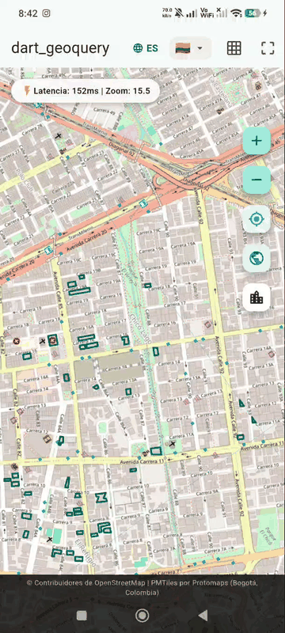

# dart_geoquery

[](https://pub.dev/packages/dart_geoquery)
[](LICENSE)
[]()

Serverless, offline geospatial query engine for **PMTiles** (and Mapbox Vector Tiles) in pure Dart, with first-class reactive interactive layers for **`flutter_map`**.

---

<p align="center">
  
  <br>
  <em>Interactive vector querying, Sutherland-Hodgman boundary stitching, and 3D globe transition running on a physical Android device.</em>
</p>

---

## 🏗️ Architecture & Packages

This repository is organized as a [Dart Pub Workspace](https://dart.dev/tools/pub/workspaces), cleanly decoupling the core pure Dart geospatial mathematics from the Flutter presentation layer:

```
dart_geoquery/
├── pubspec.yaml                 # Root Dart workspace manifest
├── doc/
│   └── demo.gif                 # Interactive demo recording
└── packages/
    ├── dart_geoquery/           # Core pure Dart engine (zero UI dependencies)
    └── dart_geoquery_flutter/   # Reactive interactive layer for flutter_map
```

| Package | Description | Dependencies |
| :--- | :--- | :--- |
| [**`dart_geoquery`**](packages/dart_geoquery) | Pure Dart spatial query engine. Point-in-polygon ray casting, tile math, cross-tile boundary stitching (Sutherland-Hodgman), Hilbert indexing, and background isolate workers. | Pure Dart (0 Flutter dependencies) |
| [**`dart_geoquery_flutter`**](packages/dart_geoquery_flutter) | Interactive selection and reactive vector styling layer for `flutter_map`. Zero base-map re-renders, debounced taps, and automatic style dispatch. | Flutter, `flutter_map`, `latlong2` |

---

## ⚡ Key Highlights

- **Serverless & 100% Offline**: Point-in-polygon queries against `.pmtiles` files directly from assets or remote URLs via HTTP Range Requests without an external GIS backend or platform views.
- **Cross-Tile Geometry Stitching**: Polygons cut by arbitrary tile boundaries (including corner and diagonal intersections) are automatically stitched and clipped to eliminate seam artifacts.
- **Background Isolate Workers**: Heavy vector tile decompression and ray-casting execute asynchronously in a long-lived isolate, keeping your UI thread at 60/120 FPS.
- **In-Memory LRU Tile Caching**: Zero duplicate decodings for warm tiles.

---

## 🧪 Running Tests

Both packages include exhaustive unit and regression test suites:

```bash
# Core geospatial engine tests (geometry math, Sutherland-Hodgman clipping, PIP)
cd packages/dart_geoquery
dart test

# Flutter interactive layer tests (controllers, widgets, coordinate adapters)
cd packages/dart_geoquery_flutter
flutter test
```

---

## 📄 License

This project is licensed under the MIT License - see the [LICENSE](LICENSE) file for details.
